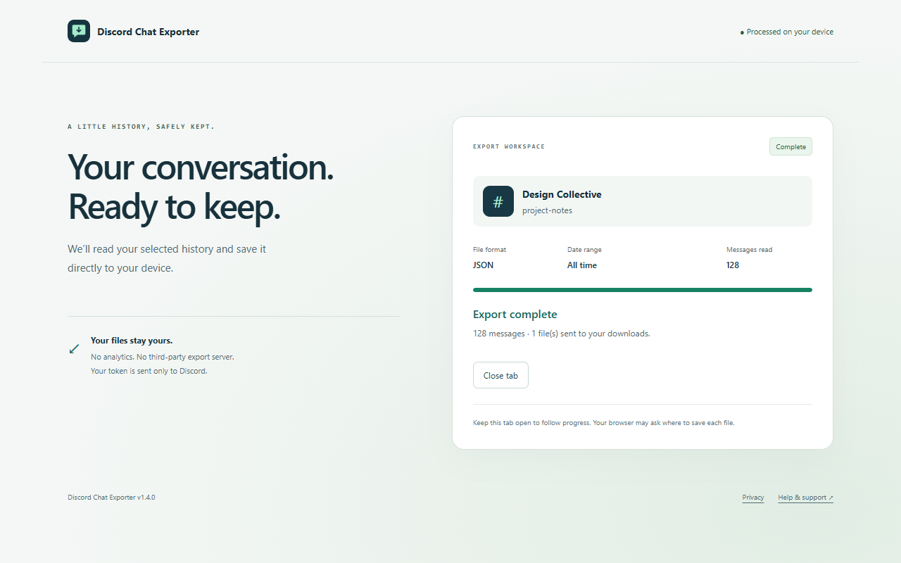

# Discord Chat Exporter

Save Discord server channels and direct messages to JSON, CSV, or readable text. Choose an inclusive UTC date range, keep all history, or export multiple channels as separate files. Version **1.4.0**.

[Chrome Web Store](https://chromewebstore.google.com/detail/discord-chat-exporter/hecekgpcppmbmajfbmdmdnpjcnhofaoa) · [Website](https://houtanrocky.github.io/discord-chat-exporter-chrome-extension/) · [Support](https://houtanrocky.github.io/discord-chat-exporter-chrome-extension/support.html) · [Privacy](https://houtanrocky.github.io/discord-chat-exporter-chrome-extension/privacy.html)



## Develop and build

Use Node.js 24 and npm. Run `npm ci`, then `npm run dev` or `npm run dev:firefox`. Production builds use `npm run build` and `npm run build:firefox`. Load `.output/chrome-mv3/` from Chrome’s extensions page, or `.output/firefox-mv2/manifest.json` as a temporary add-on in Firefox.

`npm run zip` and `npm run zip:firefox` generate browser packages. Source archives use an explicit allowlist to exclude browser profiles, private data, test artifacts, and previous release packages.

## Tests

```sh
npx playwright install chromium firefox
npm run test:all
```

- `npm test`: formatter, model, URL, date, filename, API, pagination, rate-limit, cancellation, and export-service regression tests with Node’s test runner.
- `npm run test:coverage`: unit-test coverage, including source file line/branch/function results.
- `npm run test:e2e`: browser tests after building both targets. Chromium loads the native MV3 extension and verifies actual downloaded JSON/CSV/TXT files. Both Chromium and Firefox test the built UI, accessibility, error/retry flows, responsive pages, and public internal links. Firefox UI tests simulate extension APIs; native Firefox add-on lifecycle and real Discord access still need the manual release checks.
- GitHub Actions runs the complete suite on pushes to main and pull requests.

Tests use synthetic messages and a fake token, never a personal account. The browser helper uses Playwright’s matching installed browser by default; environment variables `PLAYWRIGHT_CHROMIUM_EXECUTABLE` and `PLAYWRIGHT_FIREFOX_EXECUTABLE` can select compatible installed builds. Cached-browser fallback is reported explicitly; install the matching browsers if their protocols differ.

## Release assets

The upload-ready kit is in [`release/1.4.0/`](release/1.4.0/README.md): five screenshots, marquee and small promotional tiles, an original vector logo and PNG icons, listing copy, dashboard/privacy guidance, reviewer notes, release notes, and browser ZIPs.

```sh
npm run brand
npm run build
npm run build:firefox
npm run screenshots
npm run zip
npm run zip:firefox
node scripts/package-release.mjs
npm run release:verify
```

Screenshots are captured from the actual built Chromium extension with a deterministic API fixture. Original captures and provenance are retained; no private messages are needed. Promotional tiles use these captures and the original vector mark. No generated UI mockups are used.

## Website

The static GitHub Pages site lives in `docs/`. `npm run site:dev` serves it at http://127.0.0.1:4173/docs/. The homepage includes canonical URLs, descriptive metadata, social previews, structured application data, and a sitemap. Support and privacy have their own permanent URLs.

`.github/workflows/pages.yml` publishes `docs/` using the official GitHub Pages actions once committed to main. The initial publication can use `node scripts/publish-site.mjs`, which publishes a site-only snapshot on the dedicated `gh-pages` branch and enables Pages with GitHub Actions. It requires repository push/admin rights and a logged-in GitHub CLI. It does not stage or commit application changes in the current branch. Avoid running both publication paths simultaneously.

## Privacy and scope

An API token is an explicit user input. It is sent directly to Discord, kept in browser session storage where supported, and removable with Clear. A disclosed local-storage fallback applies where session storage is unavailable. There is no developer-operated export backend, analytics, advertising, token extraction, or browser sync. Exported files stay wherever the user saves them.

Attachment URLs may expire; attachments themselves are not downloaded. Threads, forum posts, voice channels, and deleted messages are excluded. Bulk export stops on the first error and retains completed files. Large histories depend on browser memory and API availability. Only export content you are authorized to access and follow Discord’s terms. This project is independent of Discord.
